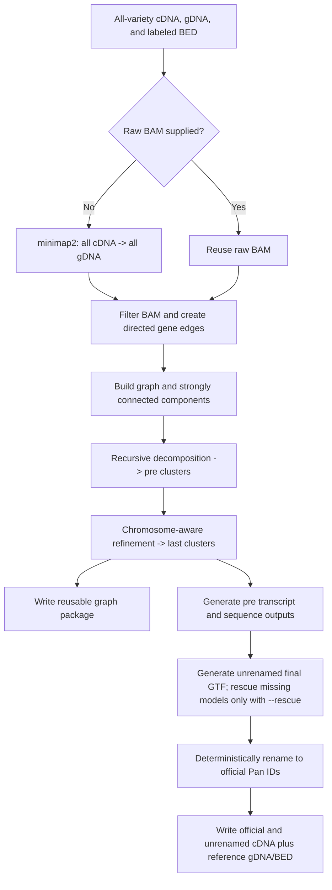
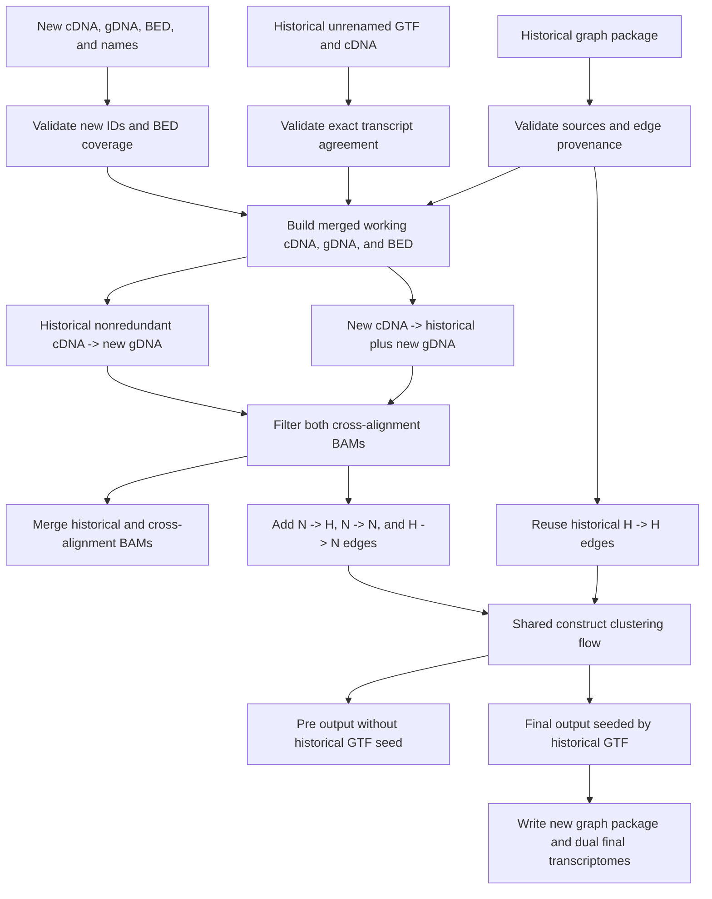

# PanTrans Building Process

[中文版](BUILDING_PROCESS.zh-CN.md)

This document describes the current PanTrans 0.6.0 implementation. It covers both a new multi-variety build with `construct` and a chained incremental update with `append`.

## 1. Core Model

PanTrans treats each gene sequence as a graph node. A transcript alignment from a source gene to a target gene creates a directed edge:

```text
source_gene -> target_gene
```

The graph is clustered in two levels:

- `pre` clusters are produced from strongly connected components and recursive graph decomposition.
- `last` clusters are the final chromosome-aware clusters used to generate the pan-genome and pan-transcriptome reference outputs.

For multi-gene SCC decomposition, representatives are selected only from genes on configured main chromosomes; Ctg genes can be representatives only for singleton components. During `last` assignment, Ctg genes are withheld from coordinate-based variety assignment and attached to a candidate cluster only when they have a direct reciprocal graph edge with a member, preferring a reciprocal homolog from the same variety. Ctg genes without such a homolog remain singleton clusters.

The first gene in each cluster is its representative. Reference preference during tie-breaking uses the BED column-5 variety label. Final representatives receive deterministic official IDs such as `PanChr1A000001` (`Pan` + the representative gene's exact BED chromosome name + a six-digit ordinal), while an additional unrenamed transcriptome keeps the original representative IDs for later incremental append runs.

## 2. Input and ID Conventions

| Input | Meaning | Required ID rule |
| --- | --- | --- |
| cDNA FASTA | Transcript sequences | Transcript IDs normally end in a numeric suffix, for example `CS.g1.1` |
| gDNA FASTA | Gene sequences used as alignment targets | FASTA IDs are gene IDs, for example `CS.g1` |
| BED | Gene coordinates, variety, and strand | Column 4 is the gene ID, column 5 is the variety, column 1 is the chromosome or contig |
| Variety names | Derived from BED column 5 | Every gene must have a non-empty variety label |
| Historical GTF | Previous unrenamed final transcript models | GTF sequence name must equal `gene_id`; transcript IDs use `<gene_id>.<number>` |

Gene IDs must be unique across historical and newly appended varieties. Variety identity is taken from BED column 5, so gene-ID prefixes do not need to encode the variety.

## 3. Shared Alignment and Filtering

Unless a reusable raw BAM is supplied, PanTrans runs splice-aware minimap2 with:

```text
-ax splice:hq -uf -I 2G -K 50M --secondary=yes -N 100 --split-prefix <task-temp-dir>/mm2
```

Each alignment (including rescue) creates a unique temporary directory beside the output BAM for split-index files and the pending BAM, and removes it on completion or failure. Both process exit codes must succeed before the BAM replaces its destination. Reserve sufficient disk space in the output filesystem. Provenance normalizes the split prefix to `<temporary>/mm2`; older alignment options remain incompatible with append.

`--threads` is shared: samtools receives `min(4, max(1, threads // 4))` threads including its main thread, and minimap2 receives the remainder (at least one). For example, `-t 8` uses minimap2 `-t 6` and samtools `-@ 1`; `-t 32` uses `-t 28` and `-@ 3`. A requested budget of one still needs one thread per process; tool I/O/helper threads are additional, so this is not an OS thread cap.

The SAM stream is converted directly to BAM with `samtools view`. PanTrans then writes a separate filtered BAM using the following criteria:

| Metric | Rule |
| --- | --- |
| Query coverage | `matched_query_length / query_length >= 0.80` |
| Approximate identity | `1 - NM / aligned_length >= 0.90` |
| Soft clipping | `soft_clipped_length / query_length <= 0.10` |

All three conditions must pass. Alignments to targets absent from BED are ignored. A transcript aligned to its own source gene is retained directly. Supplementary and unmapped records do not generate graph edges.

The filtered BAM receives the marker `pantrans-filtered=pantrans-filter-v1` in its header. Alignment provenance records the PanTrans version, minimap2 version and options, filtering thresholds, and filter logic ID.

## 4. Construct Workflow



### 4.1 Normalize Inputs

`construct` loads:

- all cDNA transcript lengths;
- all gDNA gene IDs and target lengths;
- BED coordinates and strand information;
- the ordered variety list from BED column 5;
- the optional main-chromosome list;
- the required reference variety.

The sequence-backed gene set whose BED labels occur in the ordered variety list becomes the eligible gene set for clustering.

### 4.2 Align and Filter

If `--bam` is absent, PanTrans aligns all cDNA against all gDNA and writes:

```text
<prefix>_cdna_align_gdna.bam
```

If `--bam` is present, this alignment is skipped. In both cases the selected BAM is filtered into:

```text
<prefix>_cdna_align_gdna.filtered.bam
```

Each retained transcript-to-gene alignment becomes a directed gene edge after the final transcript suffix is removed from the query ID.

### 4.3 Build and Cluster the Graph

PanTrans performs the following graph operations:

1. Build a directed graph from the retained gene pairs.
2. Find strongly connected components with NetworkX.
3. Recursively decompose multi-gene components by selecting representative genes and retaining strongly supported mutual relationships.
4. Produce `pre` clusters.
5. Split or refine clusters using BED chromosome assignments and the configured main-chromosome set.
6. Produce final `last` clusters.
7. Recover eligible sequence-backed genes absent from the filtered graph as singleton clusters so they are not silently lost.

Both cluster files are tab-separated, one cluster per line:

```text
<prefix>_pre.tmp.cluster
<prefix>_last.tmp.cluster
```

### 4.4 Persist the Graph Package

Every successful construct run writes:

```text
<prefix>.graph.json
<prefix>.graph.edges.tsv
<prefix>.graph.nodes.tsv
```

The package contains:

- sorted unique directed graph edges;
- every historical graph node with target length and BED metadata;
- source BED and filtered BAM identities;
- source cDNA and gDNA paths with file size and nanosecond modification time;
- variety order, reference variety, and main chromosomes;
- edge-generation provenance.

Sidecar edge and node paths are stored relative to the manifest. External sequence, BED, and BAM sources must remain unchanged; loading fails if their recorded size or modification time no longer matches.

### 4.5 Generate Transcript Models

For each cluster representative, PanTrans extracts the best alignment for each candidate transcript and reconstructs exon coordinates and splice intervals.

Candidates are grouped by splice-pattern containment. For each group, the longest valid transcript is selected as the representative isoform. GTF coordinates are clamped to the representative gene length.

The `pre` output is written with original IDs:

```text
<prefix>_pre.gtf
<prefix>_pre_cdna.refer.fasta
<prefix>_pre_gdna.refer.fasta
<prefix>_pre.refer.bed
```

If `--rescue` is specified, a cluster representative with no transcript model is
first recovered from a matching model in the `pre` GTF when possible, then by a
targeted rescue alignment for remaining missing genes. Without `--rescue`, no
recovery alignment is performed.

### 4.6 Write Dual Final Transcriptomes

Final `last` output is generated in two forms:

1. Transcript deduplication writes `<prefix>_unrenamed.gtf` with original representative gene IDs; rescue is added only when `--rescue` is specified.
2. PanTrans validates each transcript ID as `<original_gene_id>.<numeric_suffix>`.
3. The GTF `gene_id` and `transcript_id` attributes are mapped through the deterministic `Pan...` rename map while preserving the numeric transcript suffix. GTF column 1 remains the original representative sequence name so the coordinates still refer to the original gDNA record.
4. The official GTF is sorted by Pan gene order.
5. cDNA is reconstructed independently from both GTF files.

The final outputs are:

```text
<prefix>_unrenamed.gtf
<prefix>_unrenamed_cdna.refer.fasta
<prefix>.gtf
<prefix>_cdna.refer.fasta
<prefix>_gdna.refer.fasta
<prefix>.refer.bed
```

The two GTF/cDNA pairs describe the same final transcript models. Their attribute and FASTA IDs differ: the unrenamed pair is the chaining interface for `append`, while the official pair is the public `Pan...` result.

## 5. Append Workflow

For a historical set `H` and a new set `N`, append reuses `H -> H` graph edges and computes only relationships involving `N`.



### 5.1 Append Input Contract

| Option | Role |
| --- | --- |
| `--cdna` | Previous run's `<prefix>_unrenamed_cdna.refer.fasta` |
| `--history-gtf` | Matching previous `<prefix>_unrenamed.gtf` |
| `--query-cdna` | Complete cDNA FASTA for the new variety |
| `--gdna` | Complete gDNA FASTA for the new variety |
| `--bed` | Historical pre-cluster representatives plus every new gene; column 5 must label every row |
| `--history-graph` | Graph package from the previous construct or append run |
| `--query-to-all-bam` | Optional raw BAM for new cDNA against merged gDNA |
| `--history-to-query-bam` | Optional raw BAM for historical cDNA against new gDNA |

`--cdna` no longer means the new-variety cDNA. The new-variety transcript input is always `--query-cdna`.

### 5.2 Validate Historical State

Before alignment, append validates:

- the graph manifest format and sidecar identities;
- every recorded external source identity;
- historical minimap2 options, version, filter thresholds, and filter logic compatibility;
- no duplicate variety names between history and the new input;
- no duplicate gene IDs between historical and new gDNA;
- every historical and new gene has exactly one BED column-5 variety label;
- every query cDNA gene exists in query gDNA;
- exact equality between historical GTF transcript IDs and historical cDNA FASTA IDs;
- historical GTF sequence names equal their `gene_id` attributes;
- historical transcript IDs follow `<gene_id>.<number>`;
- historical GTF genes belong to the historical graph and do not use official `Pan...` IDs.

These checks fail before minimap2 starts.

### 5.3 Build Merged Working Inputs

Append writes:

```text
<prefix>_merged.cdna.fasta
<prefix>_merged.gdna.fasta
<prefix>_merged.bed
```

The working cDNA contains only the previous nonredundant historical cDNA plus the new complete cDNA. The original complete historical cDNA files recorded by older graph packages are not reintroduced as alignment queries.

The merged gDNA contains all historical gDNA parts from the graph package plus the new gDNA. The merged BED starts from the complete historical BED and adds rows from the append BED. Historical rows take precedence; conflicting duplicate rows are rejected, and every new gene must be present.

### 5.4 Compute Two Cross-Alignment Blocks

Append creates two raw alignment blocks:

```text
new cDNA -> historical plus new gDNA
historical nonredundant cDNA -> new gDNA
```

They generate the new edge classes:

```text
N -> H
N -> N
H -> N
```

Historical `H -> H` edges come directly from the graph package and are not recomputed.

If a resume BAM is supplied, PanTrans requires it to be raw rather than already PanTrans-filtered. Its target header must exactly match the expected gDNA target names and lengths. The set of primary query records, including primary unmapped records, must exactly match the expected cDNA transcript IDs. Secondary and supplementary records do not affect this query-set check.

Both raw BAMs are filtered with the current thresholds. The output BAMs are:

```text
<prefix>_query_to_all.filtered.bam
<prefix>_history_to_query.filtered.bam
```

### 5.5 Merge BAM and Graph State

The historical filtered BAM and both filtered cross-alignment BAMs are merged into:

```text
<prefix>_merged_cdna_align_gdna.filtered.bam
```

BAM references are validated and remapped by reference name against the full merged target header; numeric reference IDs are not assumed to match between BAM files.

The graph edge stream is the union of:

- historical graph-package edges;
- edges from the filtered new-to-all BAM;
- edges from the filtered history-to-new BAM.

The merged graph is passed to the same `_derive_graph_and_clusters()` helper used by construct, with historical varieties followed by new varieties, the original reference variety, the original main-chromosome configuration, and every historical or new sequence-backed gene as an eligible node.

### 5.6 Seed Final Transcript Deduplication

Append `pre` output uses only candidates reconstructed from the merged filtered BAM.

Append final `last` output additionally loads the previous unrenamed GTF as an authoritative seed:

- historical exon coordinates and splice intervals are reconstructed from the GTF;
- a historical seed is used only if its original representative gene is still a key in the current `last` cluster dictionary;
- seed records override BAM candidates with the same transcript ID;
- seeds whose representative changed are counted and skipped because their coordinates cannot be projected onto another representative sequence without alignment;
- seeded and BAM-derived candidates then pass through the normal splice-pattern grouping and longest-transcript selection.

The result is again written first as an unrenamed GTF/cDNA pair and then deterministically converted to the official `Pan...` pair.

### 5.7 Write the Next Graph Package

Append writes a new graph package containing the merged graph, merged node state, merged filtered BAM, accumulated source gDNA parts, the historical nonredundant cDNA plus new cDNA, and all edge-provenance generations.

This package and the new unrenamed GTF/cDNA pair are the historical inputs for the next append.

## 6. Chained Append

```text
construct output
  -> graph.json
  -> _unrenamed.gtf
  -> _unrenamed_cdna.refer.fasta

append variety 1
  -> new graph.json
  -> new _unrenamed.gtf
  -> new _unrenamed_cdna.refer.fasta

append variety 2
  -> repeat with the latest three historical artifacts
```

Always use all three artifacts from the same successful run. Mixing a graph package with a GTF/cDNA pair from another run is rejected by validation or can create an invalid coordinate model.

## 7. Main Output Files

| File | Purpose |
| --- | --- |
| `<prefix>_pre.tmp.cluster` | Intermediate graph-derived clusters |
| `<prefix>_last.tmp.cluster` | Final chromosome-aware clusters |
| `<prefix>_pre.gtf` | Pre-cluster transcript models with original IDs |
| `<prefix>_unrenamed.gtf` | Final transcript models with original representative IDs |
| `<prefix>.gtf` | Final transcript models with official `Pan...` IDs |
| `<prefix>_unrenamed_cdna.refer.fasta` | Chaining cDNA for a later append |
| `<prefix>_cdna.refer.fasta` | Official final cDNA |
| `<prefix>_gdna.refer.fasta` | Final representative gene sequences |
| `<prefix>.refer.bed` | Final representative BED rows |
| `<prefix>.graph.json` | Reusable graph manifest |
| `<prefix>.graph.edges.tsv` | Sorted unique directed graph edges |
| `<prefix>.graph.nodes.tsv` | Node lengths and BED metadata |

## 8. Failure and Resume Behavior

- Source identity, provenance, ID, GTF/cDNA, and BED validation errors stop append before alignment.
- A failed cross-alignment can be resumed with its raw BAM option.
- Reused BAMs are always re-filtered by the current PanTrans run.
- Already PanTrans-filtered BAMs are rejected as resume inputs because the raw alignment records and provenance are required.
- Missing current transcript models are recovered from `pre` output or targeted rescue alignment only when `--rescue` is specified; otherwise they remain absent.
- Historical GTF models whose representative is no longer current are skipped, not projected.

## 9. Expected Equivalence and Non-Goals

Incremental append is designed to preserve the complete historical graph while avoiding historical cDNA-to-historical gDNA realignment. It targets high similarity to a monolithic construct run, not byte-identical output.

The minimap2 `-N 100` limit means separately evaluated target sets can retain a small number of secondary edges that would be displaced in one monolithic alignment. Cluster representative choices can therefore differ in edge cases even when the biological graph is highly similar.

PanTrans does not currently:

- recompute all original historical cDNA alignments during append;
- project historical GTF coordinates onto a different representative gene;
- guarantee byte-identical incremental and monolithic graphs or clusters;
- treat a representative-only historical sequence set as a replacement for the complete historical graph.

## 10. Implementation Map

The independent `translocation` subcommand reads pre clusters, complete BED
coordinates, a main-chromosome list and the directed edge TSV from a completed
run. It compares every non-reference variety to `-r`, requires direct reciprocal
edges within a pre cluster, and excludes same-chromosome alternatives, multiple
matches and unplaced genes from block anchors. By default, supported candidate
blocks require three distinct pre clusters, at most 1 Mb between neighboring
anchors on each side and at most five intervening BED genes. Reversed gene order
is optional. Gene and block TSVs retain ambiguous and low-support evidence; no
alignment or cluster modification occurs. See the README for options and status
definitions. Unplaced pairs are excluded from reports and ambiguity counts by
default; `--include-unplaced` includes them as `unplaced` without allowing block
anchoring. The implementation is `src/pantrans/translocation.py`.

| Responsibility | Module |
| --- | --- |
| CLI and input mapping | `src/pantrans/main.py` |
| Construct and append orchestration | `src/pantrans/pipeline.py` |
| Alignment, filtering, BAM merge, provenance | `src/pantrans/align_filter.py` |
| Directed graph clustering | `src/pantrans/construct_di_graph.py` |
| Graph package persistence and validation | `src/pantrans/graph_package.py` |
| GTF parsing, transcript deduplication, renaming, cDNA extraction | `src/pantrans/transcript_processor.py` |
