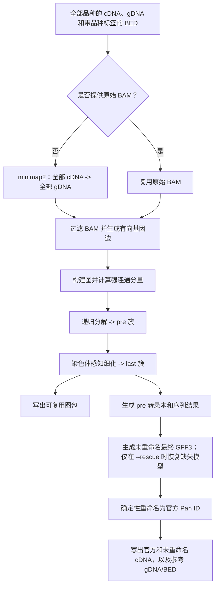
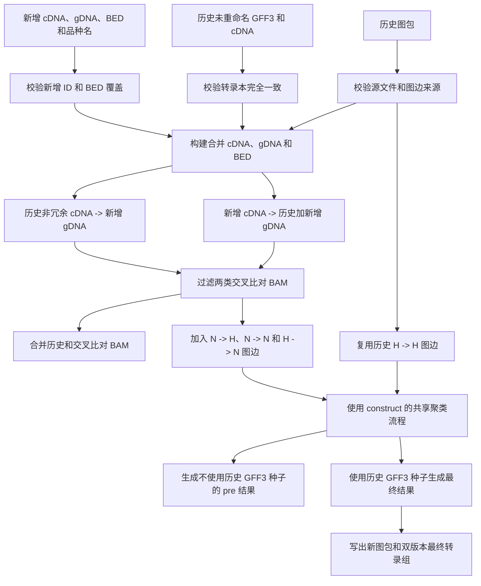

# PanTrans 构建流程

[English](BUILDING_PROCESS.md)

本文档描述 PanTrans 0.7.0 的当前实现，包括使用 `construct` 进行多品种全新构建，以及使用 `append` 进行可连续追加的增量更新。

## 1. 核心模型

PanTrans 将每条基因序列视为图节点。一个来源基因的转录本比对到目标基因时，会生成一条有向边：

```text
source_gene -> target_gene
```

图聚类分为两级：

- `pre` 簇由强连通分量和递归图分解产生。
- `last` 簇是在染色体信息约束下进一步细化的最终簇，用于生成泛基因组和泛转录组参考结果。

多基因 SCC 递归分解时，只从配置的主染色体基因中选择代表基因；Ctg 仅在其自身为单成员分量时才能作为代表。生成 `last` 簇时，Ctg 不参与按品种和坐标分组；只有当其与候选簇成员存在直接双向图边时才并入该簇，同品种的双向同源基因优先。找不到此类同源基因的 Ctg 保持为单基因簇。

每个簇的第一个基因是代表基因。代表选择发生平局时使用 BED 第 5 列的参考品种标签。最终代表基因会获得 `PanChr1A000001` 这类确定性的官方 ID：`Pan` + 该代表基因对应的 BED 染色体原名 + 至少六位的顺序编号，不改写或合并染色体名称。同时，PanTrans 还输出保留原始代表 ID 的未重命名转录组，供后续增量 append 使用。

## 2. 输入与 ID 约定

| 输入 | 含义 | ID 规则 |
| --- | --- | --- |
| cDNA FASTA | 转录本序列 | 转录本 ID 通常以数字后缀结尾，例如 `CS.g1.1` |
| gDNA FASTA | 作为比对目标的基因序列 | FASTA ID 为基因 ID，例如 `CS.g1` |
| BED | 基因坐标、品种和链方向 | 第 4 列为基因 ID，第 5 列为品种名，第 1 列为染色体或 contig |
| 品种名称 | 从 BED 第 5 列读取 | 每个基因必须有非空品种标签 |
| 历史 GFF3 | 上一次运行生成的未重命名最终转录本模型 | GFF3 序列名必须等于 gene 的 `ID`，转录本 ID 为 `<gene_id>.<数字>` |

历史品种与新增品种之间不能出现重复基因 ID。品种身份来自 BED 第 5 列，因此基因 ID 不再需要编码品种前缀。

## 3. 通用比对与过滤

如果没有提供可复用的原始 BAM，PanTrans 使用以下参数运行剪接感知的 minimap2：

```text
-ax splice:hq -uf -I 2G -K 50M --secondary=yes -N 100 --split-prefix <task-temp-dir>/mm2
```

每次比对（包括 rescue）在输出 BAM 所在目录创建独占临时目录，存放分片合并文件和待完成的 BAM，结束或失败后清理。仅当两个进程均成功退出时才替换目标 BAM；输出文件系统需预留临时磁盘空间。provenance 将分片前缀规范化为 `<temporary>/mm2`；旧比对参数仍会被 append 判为不兼容。

`--threads` 为共享预算：samtools 分配 `min(4, max(1, threads // 4))` 个线程（包含主线程），minimap2 使用剩余线程（至少一个）。例如 `-t 8` 对应 minimap2 `-t 6` 与 samtools `-@ 1`；`-t 32` 对应 `-t 28` 与 `-@ 3`。预算为 1 时管道仍需两个进程各一个线程；工具的 I/O/辅助线程额外计算，因此该预算不是操作系统线程数硬上限。

SAM 流通过 `samtools view` 直接转换为 BAM。随后 PanTrans 根据以下标准生成单独的过滤 BAM：

| 指标 | 条件 |
| --- | --- |
| 查询覆盖度 | `matched_query_length / query_length >= 0.80` |
| 近似一致性 | `1 - NM / aligned_length >= 0.90` |
| 软截断比例 | `soft_clipped_length / query_length <= 0.10` |

三个条件必须同时满足。目标基因不在 BED 中的比对会被忽略。转录本比对到自身来源基因时直接保留。补充比对和未比对记录不会生成图边。

过滤 BAM 的头部会写入 `pantrans-filtered=pantrans-filter-v1` 标记。比对来源信息会记录 PanTrans 版本、minimap2 版本和参数、过滤阈值以及过滤逻辑 ID。

## 4. Construct 流程



### 4.1 规范化输入

`construct` 会加载：

- 全部 cDNA 的转录本长度；
- 全部 gDNA 的基因 ID 和目标长度；
- BED 坐标和链方向；
- 从 BED 第 5 列读取的有序品种列表；
- 可选的主染色体列表；
- 必需的参考品种。

BED 第 5 列标签属于有序品种列表、且有序列支持的基因构成可参与聚类的基因集合。

### 4.2 比对与过滤

未提供 `--bam` 时，PanTrans 将全部 cDNA 比对到全部 gDNA，并生成：

```text
<prefix>_cdna_align_gdna.bam
```

提供 `--bam` 时跳过该比对。无论使用哪种方式，选定的 BAM 都会被过滤为：

```text
<prefix>_cdna_align_gdna.filtered.bam
```

保留的每条转录本到基因比对，在去掉查询转录本 ID 的最后一级后缀后，转换为一条有向基因边。

### 4.3 构图与聚类

PanTrans 执行以下图操作：

1. 根据保留的基因配对构建有向图。
2. 使用 NetworkX 计算强连通分量。
3. 选择代表基因，并根据可靠的双向关系递归分解多基因分量。
4. 生成 `pre` 簇。
5. 使用 BED 染色体信息和指定的主染色体集合进一步拆分或细化簇。
6. 生成最终 `last` 簇。
7. 将未出现在过滤图中的、但有序列支持的有效基因恢复为单基因簇，避免静默丢失。

两个簇文件均为制表符分隔，每行一个簇：

```text
<prefix>_pre.tmp.cluster
<prefix>_last.tmp.cluster
```

### 4.4 保存图包

每次成功的 construct 都会生成：

```text
<prefix>.graph.json
<prefix>.graph.edges.tsv
<prefix>.graph.nodes.tsv
```

图包包含：

- 排序并去重的有向图边；
- 每个历史图节点的目标长度和 BED 元数据；
- 源 BED 和过滤 BAM 的文件身份；
- 源 cDNA 和 gDNA 路径、文件大小及纳秒级修改时间；
- 品种顺序、参考品种和主染色体；
- 图边生成来源信息。

图边和节点旁车文件以相对于清单的位置记录。外部序列、BED 和 BAM 源文件必须保持不变；若文件大小或修改时间与记录不一致，加载图包会失败。

### 4.5 生成转录本模型

对于每个簇代表基因，PanTrans 会为每个候选转录本选择最佳比对，并重建外显子坐标和剪接区间。

候选转录本按照剪接模式的包含关系分组，每组选择最长的有效转录本作为代表异构体。GFF3 坐标会限制在代表基因长度范围内。

`pre` 结果使用原始 ID：

```text
<prefix>_pre.gff3
<prefix>_pre_cdna.refer.fasta
<prefix>_pre_gdna.refer.fasta
<prefix>_pre.refer.bed
```

只有显式指定 `--rescue` 时，才会对缺少转录本模型的簇代表进行恢复：先尝试复用 `pre` GFF3 中的匹配模型，再对仍缺失的基因执行定向补救比对。未指定时不执行恢复比对。

### 4.6 写出双版本最终转录组

最终 `last` 结果以两种形式生成：

1. 转录本去冗余先生成 `<prefix>_unrenamed.gff3`，使用原始代表基因 ID；只有指定 `--rescue` 时才追加恢复流程。
2. PanTrans 校验每个转录本 ID 是否为 `<原始基因ID>.<数字后缀>`，并提取未重命名 cDNA。
3. 指定 `--annotate-cds` 时，对该 cDNA 运行一次 TransDecoder，再沿 exon 映射 CDS 坐标。GFF3 CDS 包含终止密码子，仅在可信 ORF 边界添加 UTR；跨外显子的 CDS 共用 ID，按转录方向计算 phase。
4. 通过确定性的 `Pan...` 映射替换 GFF3 各层级的 `ID` 和 `Parent` 属性，同时保留转录本数字后缀。GFF3 第 1 列仍保留原始代表序列名，使坐标继续对应原始 gDNA 记录。
5. 官方 GFF3 排序时保证父特征先于子特征，并从中提取官方 cDNA。

所有新注释（包括 pre 和 rescue 中间文件）均含单个 `##gff-version 3` 头，
使用 gene/mRNA/exon 层级。append 使用 `--history-gff3`；为迁移历史结果，
仍支持旧 GTF 输入及 `--history-gtf` 别名，但不再生成新的 GTF 文件。

最终输出包括：

```text
<prefix>_unrenamed.gff3
<prefix>_unrenamed_cdna.refer.fasta
<prefix>.gff3
<prefix>_cdna.refer.fasta
<prefix>_gdna.refer.fasta
<prefix>.refer.bed
```

两组 GFF3/cDNA 描述相同的最终转录本模型，但属性和 FASTA ID 不同：未重命名版本是后续 `append` 的衔接接口，官方版本是公开使用的 `Pan...` 结果。

## 5. Append 流程

对于历史集合 `H` 和新增集合 `N`，append 复用 `H -> H` 历史图边，只计算涉及 `N` 的关系。



### 5.1 Append 输入契约

| 参数 | 作用 |
| --- | --- |
| `--cdna` | 上一次运行的 `<prefix>_unrenamed_cdna.refer.fasta` |
| `--history-gff3` | 与之配套的 `<prefix>_unrenamed.gff3` |
| `--query-cdna` | 新增品种的完整 cDNA FASTA |
| `--gdna` | 新增品种的完整 gDNA FASTA |
| `--bed` | 历史 pre 簇代表基因加全部新增基因；第 5 列必须标注每行品种 |
| `--history-graph` | 上一次 construct 或 append 生成的图包 |
| `--query-to-all-bam` | 可选：新增 cDNA 对合并 gDNA 的原始 BAM |
| `--history-to-query-bam` | 可选：历史 cDNA 对新增 gDNA 的原始 BAM |

`--cdna` 不再表示新增品种 cDNA。新增品种转录本输入始终使用 `--query-cdna`。

### 5.2 校验历史状态

append 在开始比对前会校验：

- 图包清单格式和旁车文件身份；
- 每个已记录外部源文件的身份；
- 历史 minimap2 参数、版本、过滤阈值和过滤逻辑与当前运行兼容；
- 历史品种和新增品种之间没有重复品种名；
- 历史 gDNA 与新增 gDNA 之间没有重复基因 ID；
- 每个历史和新增基因都有且只有一个 BED 第 5 列品种名；
- 每个查询 cDNA 基因都存在于查询 gDNA；
- 历史 GFF3 转录本 ID 与历史 cDNA FASTA ID 完全相等；
- 历史 GFF3 序列名等于其 gene 的 `ID`；
- 历史转录本 ID 符合 `<gene_id>.<数字>`；
- 历史 GFF3 基因属于历史图，且未使用官方 `Pan...` ID。

这些检查均在 minimap2 启动前失败退出。

### 5.3 构建合并工作输入

append 会生成：

```text
<prefix>_merged.cdna.fasta
<prefix>_merged.gdna.fasta
<prefix>_merged.bed
```

工作 cDNA 只包含上一次运行的历史非冗余 cDNA 和新增完整 cDNA。旧图包中记录的历史原始完整 cDNA 不会重新作为比对查询加入。

合并 gDNA 包含图包中的全部历史 gDNA 片段和新增 gDNA。合并 BED 以完整历史 BED 为基础，再加入 append BED 中的记录。历史记录优先；重复记录发生冲突时会报错，并且每个新增基因都必须存在于 BED 中。

### 5.4 计算两类交叉比对

append 创建两类原始比对：

```text
新增 cDNA -> 历史加新增 gDNA
历史非冗余 cDNA -> 新增 gDNA
```

它们产生以下新增图边：

```text
N -> H
N -> N
H -> N
```

历史 `H -> H` 图边直接来自图包，不会重新计算。

如果提供断点 BAM，PanTrans 要求它是原始 BAM，而不是已经经过 PanTrans 过滤的 BAM。目标头必须与预期 gDNA 的名称和长度完全一致。所有 primary 查询记录的集合必须与预期 cDNA 转录本 ID 完全一致，其中包括 primary unmapped 记录；secondary 和 supplementary 记录不参与该集合校验。

两类原始 BAM 都会使用当前阈值重新过滤，得到：

```text
<prefix>_query_to_all.filtered.bam
<prefix>_history_to_query.filtered.bam
```

### 5.5 合并 BAM 与图状态

历史过滤 BAM 和两类交叉比对过滤 BAM 会合并为：

```text
<prefix>_merged_cdna_align_gdna.filtered.bam
```

BAM 参考序列会根据完整合并目标头按名称校验和重映射，不假定不同 BAM 中的数字 reference ID 一致。

图边流由以下部分组成：

- 历史图包中的图边；
- 新增到全部目标的过滤 BAM 中的图边；
- 历史到新增目标的过滤 BAM 中的图边。

合并图会传入 construct 使用的同一个 `_derive_graph_and_clusters()` 函数，并使用历史品种加新增品种的顺序、原始参考品种、原始主染色体配置，以及全部有序列支持的历史和新增基因作为有效节点。

### 5.6 为最终转录本去冗余加入历史种子

append 的 `pre` 结果只使用从合并过滤 BAM 重建的候选转录本。

append 的最终 `last` 结果还会把上一次未重命名 GFF3 作为权威种子加载：

- 从 GFF3 重建历史外显子坐标和剪接区间；
- 只有原始代表基因仍是当前 `last` 簇字典键时，才使用该历史种子；
- 历史种子会覆盖同转录本 ID 的 BAM 候选；
- 如果代表基因发生变化，该种子会被计数并跳过，因为没有重新比对就不能把坐标投影到另一个代表序列；
- 历史种子和 BAM 候选随后共同执行正常的剪接模式分组和最长转录本选择。

结果仍然先写成未重命名 GFF3/cDNA，再确定性转换为官方 `Pan...` 版本。

### 5.7 写出下一代图包

append 会写出新的图包，包含合并图、合并节点状态、合并过滤 BAM、累积的源 gDNA 片段、历史非冗余 cDNA 加新增 cDNA，以及全部图边来源代次。

这个图包和新的未重命名 GFF3/cDNA 对，将作为下一次 append 的历史输入。

## 6. 连续 Append

```text
construct 输出
  -> graph.json
  -> _unrenamed.gff3
  -> _unrenamed_cdna.refer.fasta

追加品种 1
  -> 新 graph.json
  -> 新 _unrenamed.gff3
  -> 新 _unrenamed_cdna.refer.fasta

追加品种 2
  -> 使用最新的三个历史文件重复运行
```

三个历史文件必须来自同一次成功运行。混用不同运行的图包和 GFF3/cDNA 对会被校验拒绝，或导致无效的坐标模型。

## 7. 主要输出文件

| 文件 | 用途 |
| --- | --- |
| `<prefix>_pre.tmp.cluster` | 图推导出的中间簇 |
| `<prefix>_last.tmp.cluster` | 染色体感知的最终簇 |
| `<prefix>_pre.gff3` | 使用原始 ID 的 pre 簇转录本模型 |
| `<prefix>_unrenamed.gff3` | 使用原始代表 ID 的最终转录本模型 |
| `<prefix>.gff3` | 使用官方 `Pan...` ID 的最终转录本模型 |
| `<prefix>_unrenamed_cdna.refer.fasta` | 后续 append 使用的衔接 cDNA |
| `<prefix>_cdna.refer.fasta` | 官方最终 cDNA |
| `<prefix>_gdna.refer.fasta` | 最终代表基因序列 |
| `<prefix>.refer.bed` | 最终代表基因 BED |
| `<prefix>.graph.json` | 可复用图包清单 |
| `<prefix>.graph.edges.tsv` | 排序并去重的有向图边 |
| `<prefix>.graph.nodes.tsv` | 节点长度和 BED 元数据 |

## 8. 失败与断点续跑

- 源文件身份、来源信息、ID、GFF3/cDNA 和 BED 校验错误会在 append 比对前终止运行。
- 交叉比对失败后，可以通过对应的原始 BAM 参数断点续跑。
- 复用 BAM 始终由当前 PanTrans 重新过滤。
- 已经过 PanTrans 过滤的 BAM 不能作为断点输入，因为流程需要原始比对记录和来源信息。
- 只有指定 `--rescue` 时，当前缺失的转录本模型才会从 `pre` 结果或定向补救比对中恢复；否则保持缺失。
- 代表基因已经改变的历史 GFF3 模型会被跳过，而不会进行坐标投影。

## 9. 等价性预期与非目标

增量 append 的目标是在避免历史 cDNA 对历史 gDNA 重比对的同时，完整保留历史图。它追求与一次性 construct 高度相似，而不是逐字节完全相同。

minimap2 的 `-N 100` 限制意味着，分开评估目标集合时可能保留少量在一次性全量比对中会被挤掉的次级图边。因此，即使生物学关系图高度相似，少数边界情况下的簇代表也可能不同。

PanTrans 当前不会：

- 在 append 中重新计算全部历史原始 cDNA 比对；
- 将历史 GFF3 坐标投影到另一个代表基因；
- 保证增量图、簇与一次性构建逐字节完全一致；
- 使用仅包含历史代表基因的序列集替代完整历史图。

## 10. 实现模块对应关系

独立子命令 `translocation` 读取已有 pre cluster、完整 BED、主染色体列表和有向图边 TSV，
将每个非参考品种与 `-r` 比较。只接受同一 pre cluster 内的直接双向连接，
有同染色体替代匹配、多重匹配或未定位基因的关系不作为区段锚点。
默认支持区段至少包含三个不同 pre cluster，锚点两侧的相邻间隔均不超过 1 Mb，
中间均最多跳过五个 BED 基因；可选接受反向排列。
基因和区段 TSV 保留歧义及支持不足的候选，不重新比对或修改聚类。
默认从报告和歧义统计中排除未定位基因对；`--include-unplaced` 显式纳入后仍只标为
`unplaced`，不作为区段锚点。参数和状态说明见 README，实现位于 `src/pantrans/translocation.py`。

| 职责 | 模块 |
| --- | --- |
| CLI 和输入参数映射 | `src/pantrans/main.py` |
| Construct 与 append 流程编排 | `src/pantrans/pipeline.py` |
| 比对、过滤、BAM 合并和来源信息 | `src/pantrans/align_filter.py` |
| 有向图聚类 | `src/pantrans/construct_di_graph.py` |
| 图包保存与校验 | `src/pantrans/graph_package.py` |
| GFF3 解析、转录本去冗余、重命名和 cDNA 提取 | `src/pantrans/transcript_processor.py` |
